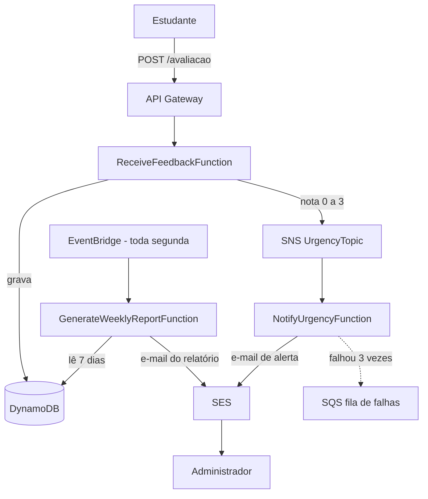

# Feedback Platform — Tech Challenge Fase 4

Plataforma serverless na AWS em que estudantes avaliam aulas e administradores recebem
alertas de avaliações críticas e um relatório semanal.

- **Documentação completa:** [docs/documentacao.pdf](docs/documentacao.pdf)
- **Vídeo de demonstração:** https://www.youtube.com/watch?v=DsFaaihU6cw

## Como funciona

1. O estudante envia descrição e nota pelo endpoint `POST /avaliacao`.
2. O sistema grava a avaliação e calcula a urgência a partir da nota.
3. Nota de 0 a 3 gera um e-mail de alerta imediato ao administrador.
4. Toda segunda-feira o administrador recebe o relatório semanal, com a média e as contagens.

| Nota | Urgência | Alerta imediato |
|---|---|---|
| 0 a 3 | ALTA | Sim |
| 4 a 6 | MÉDIA | Não |
| 7 a 10 | BAIXA | Não |

## Arquitetura



## Funções

| Função | Gatilho | Responsabilidade |
|---|---|---|
| `ReceiveFeedbackFunction` | API Gateway, `POST /avaliacao` | Validar e gravar a avaliação; sinalizar quando é crítica |
| `NotifyUrgencyFunction` | Tópico SNS de urgência | Enviar o e-mail de alerta ao administrador |
| `GenerateWeeklyReportFunction` | EventBridge, toda segunda-feira | Montar e enviar o relatório semanal |

## Tecnologias

Java 17, Maven, AWS Lambda, API Gateway, DynamoDB, SNS, SQS, SES, EventBridge, CloudWatch,
AWS SAM / CloudFormation e JUnit 5.

## Estrutura

```
feedback-core/               domínio e acesso ao DynamoDB e ao SES (compartilhado)
receive-feedback-function/   função 1: recebe a avaliação
notify-urgency-function/     função 2: alerta de urgência
weekly-report-function/      função 3: relatório semanal
test-support/                simuladores usados nos testes
template.yaml                infraestrutura AWS
```

## Exemplo de requisição

```http
POST /avaliacao
Content-Type: application/json

{ "descricao": "A aula foi ótima", "nota": 9 }
```

Resposta `201`:

```json
{ "id": "...", "message": "Feedback registrado com sucesso." }
```

## Como executar

Pré-requisitos: Java 17, Maven 3.9+, AWS SAM CLI e dois e-mails verificados no Amazon SES
(remetente e administrador).

Gerar os pacotes e rodar os testes:

```bash
mvn package
```

Publicar na AWS:

```bash
sam deploy --guided --stack-name feedback-platform --capabilities CAPABILITY_IAM
```

Ao final, a URL da API aparece na saída `FeedbackEndpoint`.

Os detalhes de deploy, segurança e monitoramento estão na
[documentação completa](docs/documentacao.pdf).
